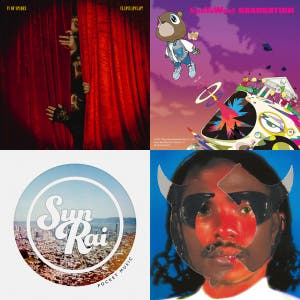
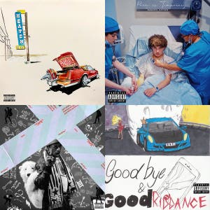
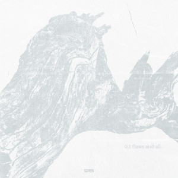

# MY PLAYLIST

 

<table>
<tr>
<td align="center" width="180">
 
<b>คนน่ารักมักใจร้าย</b> 
</td>
<td align="center" width="180">
 
<b>Telepatia</b> 
</td>
<td align="center" width="180">
 
<b>Lost Kitten</b> 
</td>
</tr>
<tr>
<td align="center" width="180">
 
<b>Out of the Box</b> 
</td>
<td align="center" width="180">
 
<b>Midnight Countdown</b> 
</td>
<td align="center" width="180">
 
<b>97</b> 
</td>
</tr>
</table>

 

##  TOP TRACK THIS MONTH

 
<b>bad</b> wave to earth 
 

